# Architecture

Wraith separates terminal semantics, rendering, and browser integration. The
`Wraith.mount()` terminal model never crosses JavaScript as a JSON screen or an array of cell
objects. Each `Wraith.mount()` instance owns a worker, a Wasm module, and a GPU device.

```mermaid
flowchart LR
    App[Application / PTY transport] --> SDK[TypeScript SDK]
    SDK -->|owned byte buffers / commands| Worker[Dedicated worker]
    Worker -->|one Wasm instance| Ghostty[libghostty-vt]
    Ghostty -->|C ABI / changed rows| Core[Retained Rust snapshot]
    Core --> Text[HarfRust / swash / glyph atlas]
    Text --> GPU[Rust wgpu / WGSL]
    GPU --> Canvas[OffscreenCanvas / WebGPU]
    Ghostty -->|responses / input encoding| Worker
    Worker --> SDK
```

## Ownership

`Core` owns a Ghostty bridge handle and a stable Rust `State` allocation. The State's address
remains stable when Core moves. Its internal raw owner prevents an owning Box
field from being retagged while foreign code retains a userdata pointer. Public
snapshot access is read-only. Ghostty callbacks may borrow it only synchronously,
inside a write or render-state update. No callback reenters the terminal. The bridge
is freed before the State, and uses Rust allocation callbacks for every Ghostty
allocation. There are no competing Zig and Rust heaps.

`native/bridge.c` is the sole translation layer for upstream C structs, sized
struct initialization, and enum constants. Rust exposes its own small `Frame`
layout. A pinned Ghostty revision and C compilation isolate upstream API churn.
The build extracts the public `ghostty_type_json()` ABI manifest from the exact
native or Wasm archive being linked. It generates inline readers for cell tags,
widths, style IDs and codepoints, avoiding generic per-cell queries. Unknown
schemas or incompatible descriptors stop the build. Both targets compare those
readers against libghostty's getters on 100,130 raw cells before compiling the
bridge. Styles and grapheme text still use the public out-of-line APIs; no private
packed layout is frozen in the source.

`Renderer` owns the device, surface, pipeline, atlas texture, cell storage buffer,
row map, uniform buffer, and CPU staging cells. `Atlas` owns font bytes, shaping metadata,
the swash scaler context, and a bounded cache keyed by grapheme and style.

The SDK copies caller-owned input once before transferring it to the worker.
String input is encoded once. Wasm bindings copy input into Wasm memory. Inside
Wasm, changed cells are copied into retained Rust storage; they do not make an
expensive trip through JavaScript. WebGPU performs its required upload copies.
This is deliberately not described as an entirely zero-copy pipeline.

V8 first runs each Wasm function on its baseline compiler and swaps in optimized
code only on a later call. The parser is entered once per write batch, so a new
terminal's first large burst would parse entirely on baseline code, and its first
frame of text would rasterize glyphs there too. After the first terminal in a
worker is ready, the worker rasterizes printable ASCII into that terminal's atlas
and parses a short mixed stream in a scratch terminal, in 1 ms steps that run
only after 8 ms without commands. See
[engine warm-up](benchmarks/engine-warmup/REPORT.md).

## A frame

1. libghostty-vt parses a streaming byte sequence and updates terminal state.
2. The worker coalesces presentation through requestAnimationFrame. Idle state
   produces no redraw, except cursor or text blinking. A write to a terminal
   that drew no frame for two frame intervals, such as a keystroke's echo,
   renders at once instead; see
   [input latency](benchmarks/input-latency/RE5224.md).
3. Ghostty updates its incremental render snapshot. The adapter visits dirty rows
   and copies their grapheme, colors, and flags into reusable Rust cell storage.
4. Atlas hits reuse an existing tile. A miss chooses a fallback font, shapes the
   grapheme with HarfRust, rasterizes with swash, and schedules one texture upload.
5. Each changed cell becomes a 20-byte GPU record: colors, flags and one glyph
   word (atlas slot, ink width, color bit). Rows that only moved are copied
   by libghostty row id and raw cells instead of re-read. A visible-to-physical row
   map retains their GPU slots. Only new or revised rows are uploaded; adjacent
   logical sources with adjacent physical destinations merge into one write.
   The GPU cell buffer stays resident between frames.
6. A single render pass issues two instanced draw calls: backgrounds first, then
   glyphs and decorations. This prevents a wide glyph from being covered by the
   next cell's background. Glyph sampling uses explicit LOD 0, so per-cell branches
   do not violate WGSL derivative-uniformity rules.
7. The command buffer is submitted and the surface texture is presented. Dirty
   flags clear only after successful submission.

Moving a cursor may dirty its previous and new rows, following Ghostty's damage
model. Scrolling changes a four-byte mapping entry per viewport row and uploads
only newly packed content. Each physical slot has one visible owner, so editing
duplicate rows cannot overwrite each other. Identity maps bypass the shader's
row lookup. Resizing replaces the slots and initializes every visible row.

Native presentation also requires a visible document and a nonzero intersection
between the canvas and its viewport/clipping ancestors. IntersectionObserver
pauses normal GPU draws for offscreen, fully clipped and display:none panels;
visible portions continue to render. Parsing, retained history, search, selection,
accessibility mirrors and stats heartbeats continue. Explicit flush still attempts
a render and waits for its GPU fence. Reveal requests a fresh presentation even
when state is already clean. Observers attach after engine initialization and
are disconnected on failure/disposal. Hosts without a working observer keep
whole-document visibility handling. Intersection delivery is asynchronous, so an
initial frame or in-flight frame can precede suspension. This is geometry-based;
it does not detect opacity, visibility:hidden or another window covering a panel.

## Terminal pool

`Wraith.pool()` creates workers lazily up to its size and assigns each new
terminal to the least-loaded worker over a dedicated `MessagePort`. The worker
runs one session per port. A session holds the state a dedicated worker keeps:
engine, canvas, animation-frame scheduling, search tasks, timers and serial
command queue. All sessions share the worker's single Wasm instance. The
renderer keeps one WebGPU instance, adapter, device and queue per worker thread,
creating them on first use and replacing them after device loss. Each terminal
creates its own surface on that device. Engine creation is serialized per
worker, so the pipeline validation scopes of concurrently mounting terminals
cannot interleave on the shared device. A device-wide validation error or loss
reaches every terminal on that device; a worker failure reaches every terminal
attached to it. Disposing a pooled terminal frees its engine and closes its
port; the worker stays for its neighbours.

## Shared surfaces

`Wraith.pool({ surface: 'shared' })` gives each pool worker one page-sized
`OffscreenCanvas`, fixed over the viewport with `pointer-events: none`
(z-index 1 by default). The worker owns that canvas's swap chain, a retained
backing texture of the same size, one compiled terminal pipeline and image
pipeline, and one glyph atlas per font configuration (font and fallback
bytes, size, line height, ligatures). Terminals keep their DOM element,
textarea, preedit, accessibility mirror and their own `<canvas>`, which is
never transferred: it remains a placeholder for layout, pointer selection
and the visibility observer.

Each terminal still parses, packs and uploads exactly as on its own canvas,
but `render` stages its uniforms instead of presenting. One animation frame
per worker renders dirty visible terminals, then draws only those with new
content into the backing (`LoadOp::Load`) with a scissor at their placement,
copies the backing to the canvas texture and presents. A draw starts with a
default-background quad, so it fully replaces the terminal's earlier pixels.
Geometry changes (scroll, pan, zoom, resize, disposal) clear the backing and
redraw every visible terminal. Off-screen terminals do not render; their
parsing and history continue.

Placement comes from the main thread. Once per animation frame the pool
measures each intersecting terminal's element (one `getBoundingClientRect`
plus `offsetWidth` for the transform scale), intersects it with the element
and its overflow-clipping ancestors, and posts changed records (id, origin,
scale, clip, in device pixels) to the owning worker. Terminals hidden by
`visibility: hidden` or `opacity: 0` on the host or an ancestor
(`checkVisibility`) are placed as hidden, and a host moved to another parent
after mount has its clipping ancestors recomputed. Unscaled placements are
rounded to whole device pixels, so they match per-canvas output exactly; a
CSS-scaled placement samples the atlas with a linear sampler. The vertex
shaders map terminal pixels to the target through that placement; with a
zero target size they keep the original own-canvas path.

A shared atlas reset (a neighbour's visible glyph set overflowed) makes every
other terminal on it stale; a stale terminal repacks before it is drawn, and
a frame in which a reset invalidated already-recorded draws is redrawn in
full. Shared pipelines blend alpha with `max`, keeping terminal pixels opaque
on the premultiplied canvas.

Limits: the canvases sit above page content at their z-index, so overlays
meant to cover terminals must stack above them. Placements follow layout one
animation frame later than the DOM, so a terminal can trail a scroll or pan
by a frame. Rotation and perspective transforms are not modelled (placement
is a translation plus uniform scale). Fallback fonts and ligatures are fixed
when a shared terminal is created. Partial CSS opacity and filters on a host
are not applied. Each worker draws all of its terminals in
one pass, so heavy output in one terminal shares that worker's frame.

## Run shaping

Packing a row first takes the per-cell path, noting whether any cell is a run
candidate: an operator character with ligatures on, or a complex-script letter.
Only rows with candidates are segmented into maximal candidate runs in one style.
A run is shaped once with HarfRust (left to right, matching the cell order). Each
glyph starts at its cluster's cell and advances within it, so the grid stays
exact. The run is rasterized onto one canvas and sliced into one tile per cell;
ligature glyphs that reach into neighbouring cells land in those cells' slices.
Cells therefore keep their own tiles, so cursor, selection, decorations and the
shader are unchanged. Shaped runs are cached by text and style. The run under the
cursor keeps per-cell glyphs. Rows packed that way are never used as copy sources
for moved rows, and a cursor move repacks the rows it left and entered.

## Kitty graphics

Ghostty parses, decodes and stores images; Wraith only draws them. The build
enables Kitty graphics for both targets. A pinned patch (`kitty-freestanding`)
lifts upstream's freestanding exclusion and returns `UnsupportedMedium` for
path-based mediums there; the bridge also disables them on native builds.
PNG payloads decode with Wuffs, which libghostty-vt already links, directly
into the buffer Ghostty will own. Images larger than 16,384 px a side are
rejected before pixels are allocated. Each screen's storage is capped by
`imageStorageLimit`.

After each update, the bridge iterates visible, non-virtual placements once and
reports viewport pixel rectangles, resolved source crops, z-layers and image
generations. Ghostty's storage generation is zero until an image is stored, so
other terminals skip this entirely. The renderer rebuilds its quad buffer only
when placements or that generation change. It uploads a texture only when an
image's generation changes, reusing same-size textures, and draws one
instanced quad per placement in the existing pass. Order: below backgrounds,
backgrounds, below text, glyphs and decorations, above text. With images below
backgrounds, cells whose background equals the default become transparent and
the pass clears to that color. Textures unused for 600 presented frames, or
beyond 256 MiB, are released.

## Command blocks

libghostty-vt parses OSC 133 and reports each step through its semantic-prompt
callback after updating the screen. On the primary screen, the bridge creates a
Ghostty tracked grid reference at the cursor for every step. Rust owns the
references, so the marks move with scrolling, page pruning and reflow, and
report no value once their rows are trimmed. Erasing the scrollback moves
references on erased rows to the screen origin instead, so a finished block
whose end resolves to the origin is treated as erased. Output text is formatted by
Ghostty between the C mark and the D mark (or the next prompt, or the cursor).
The worker posts gutter extents only after the first block exists, and only
when they change. Computing them walks from the newest block and stops at the
first block that lies entirely above the viewport. Tracked references add
bookkeeping to page operations, so Wraith caps the retained blocks at 1,000
(at most four references each). Terminals without OSC 133 hold none.

## GPU effects

Effects are opt-in and live in `effects.rs`, `effects.wgsl` and
`shader_prelude.wgsl`. The renderer holds `Option<Effects>`. While it is `None`
the frame is exactly the path above: one pass, straight to the surface, with no
effect textures, pipelines or uniform writes.

With effects on, the terminal pass (images included) targets an offscreen scene
texture in the surface format. Then, in one command buffer: bloom runs two
half-resolution separable Gaussian passes (a bright-pass with a soft knee, then
the vertical blur). One composite pass applies CRT curvature, chromatic
aberration, the bloom add, the cursor trail, scanlines and vignette. A custom
shader runs last over the composite output, or over the scene when no built-in
is on. Every effect pipeline uses one explicit bind group layout (uniforms,
source texture, linear sampler, glow texture), so a user shader may use any
subset of those bindings.

A custom shader is the user's WGSL followed by the prelude. The prelude declares
the uniforms, `iChannel0`/`iChannel0Sampler` and an entry point that calls
`mainImage`. Because the user's source comes first, compiler line numbers are the
user's. Pipelines are created inside a validation error scope that is popped
before anything changes. Errors are formatted from `getCompilationInfo()` as
`line:column: message` and reject `setEffects()`; the previous effects stay.
Errors outside the scope still reach the device's uncaptured-error handler, as
before. A shader that hangs the GPU can still lose the device.

The renderer tracks the cursor from each frame's uniforms. With a trail, a move
starts an eased head and a slower tail from their current positions. While they
travel, the native cursor is hidden in the scene and the composite draws the
swept box between them. When the trail settles, the scene is redrawn once with
the native cursor, matching the frame without effects. `needs_present` stays
true only while the trail travels, an `iTime` shader animates, or the mouse
moved for an `iMouse` shader. Those frames reuse the retained scene texture
and run only the post passes. The SDK turns the trail off while
`prefers-reduced-motion: reduce` matches, and forwards pointer positions only
when the shader reads `iMouse`. The xterm-compatible compositor shares the same
`Renderer`. Its `animate()` is driven by `requestAnimationFrame` only while
`animating` is true.

A shared surface (`pool.setEffects()`) takes effects per worker surface, not
per terminal. Per-terminal effects inside the shared pass would need a scene
texture, blur targets and three or four passes for every terminal, which is
roughly 1,000 extra textures at Fleet sizes. Instead, the surface's retained
backing becomes the effects' scene (`Effects::external_scene`), and its post
passes write the canvas texture in place of the per-frame
`copy_texture_to_texture`. That adds one composite pass, plus two
half-resolution blur passes for bloom and one pass for a custom shader, per
worker frame, whatever the terminal count. The backing gains `TEXTURE_BINDING`
only while effects are on; turning them on or off rebuilds it empty, and every
visible terminal redraws. A uniform flag marks shared post-processing: CRT
corners return transparent instead of opaque black, and the custom-shader
prelude premultiplies its result by the coverage alpha of its input, so the
page between terminals stays see-through. The cursor trail is dropped (a
surface has many cursors). While pipelines validate, the worker skips frames,
since the surface is borrowed. An animated shader keeps the worker's frame
loop requesting frames, which reuse the backing and run only the post passes.

## Input and output

Keyboard and mouse events are encoded by Ghostty, using its current modes. This
keeps legacy application cursor keys, modifiers, and Kitty keyboard behavior in
the terminal core. Browser code owns focus, composition events, pointer selection,
clipboard gestures, and safe activation of HTTP(S)/mailto OSC 8 links.

Terminal-generated replies share the same byte event path as user input.
Title and bell effects have separate typed events. Selection anchors belong to
Ghostty, so copying can use its formatter rather than reconstructing logical
lines from pixels.

`connect(url)` opens the WebSocket inside the worker. Incoming messages enter
the same serial queue as writes, resize and fences, so the page's main thread
handles neither output nor its acknowledgements, and engine output (keys,
paste, query replies) is sent from the worker before it is posted to the page's
`onBytes` listeners. With `WebSocketStream` the worker reads the next message
only after the previous one is parsed, yielding a task every 4 ms so input and
animation frames interleave. A close is reported only after every earlier
message is parsed.

The worker serializes commands. In particular, an asynchronous GPU fence holds a
Rust borrow until completion. Previously queued animation callbacks are canceled
or guarded while that borrow is active. This prevents a render callback from
recursively mutating a borrowed Wasm object.

Native search uses posted worker tasks and a 2 ms CPU budget per slice, entering
through that same serial command queue. Superseded tasks coalesce; disposal closes
the task channel. This avoids nested timer clamping while allowing input, writes,
resize and fences between bounded scan steps.

The pinned Ghostty search patch reuses encoded UTF-8 pages and byte-to-cell maps
across needles, with a 32 MiB payload limit and at most 2,048 entries per terminal.
The bridge opts into this host-managed cache and clears it **before every write
and resize**, including resets, pruning and screen changes carried in VT input.
That invalidation also supplies active-area dirty tracking. Other C API consumers
keep caching disabled and conservative active-area rescans by default. Search
windows own copies; no cached terminal pointer is dereferenced after invalidation.
The first query after a content change still encodes the history. Entries survive
clearing the search UI, and are released on the next write/resize or disposal.
Cache allocation failure falls back to uncached scanning. Per-needle ASCII
Horspool skip tables are reused across pages; non-ASCII matching stays byte exact.
Soft-wrap overlap pages belong to the active search frontier so history does not
count their matches again.

## Bounds and failures

The grid is limited to 512 per dimension and 65,536 cells, and pixel dimensions
must fit the GPU's texture limits. The atlas is 2048×2048 RGBA. If a new glyph set
would exceed capacity, it resets and rebuilds all visible rows in the same frame.
If the visible set itself exceeds capacity, rendering reports an explicit error
rather than reusing live tiles. Font bytes remain independent of atlas entries.

Synchronized output preserves the last completed snapshot. A 150 ms worker timer
releases an abandoned hold when it can safely access the engine. GPU-fenced
benchmark batches and explicit flushes do not block the application UI thread.

Pipeline creation checks a WebGPU validation scope before mount resolves. Runtime
GPU errors retain the first diagnostic and reach `onError`; outstanding work is
rejected and the worker is terminated. Device-loss recovery currently means
remounting a terminal. Teardown disposes listeners, ResizeObserver, timers, DOM,
the Wasm owner, and GPU resources; a stalled worker is terminated after a bounded
wait.

## Where to extend

| Area                                        | File / module                                                 |
| ------------------------------------------- | ------------------------------------------------------------- |
| Upstream ABI and effects                    | `native/bridge.c`                                             |
| Headless state ownership and snapshots      | `crates/wraith-engine/src/core.rs`                            |
| Shaping, fallback, rasterization, cache     | `crates/wraith-engine/src/text.rs`                            |
| Uploads, device, surface, render pass       | `crates/wraith-engine/src/gpu.rs`                             |
| GPU row ownership and upload coalescing     | `crates/wraith-engine/src/retained.rs`                        |
| Cell geometry and visual styles             | `crates/wraith-engine/src/terminal.wgsl`                      |
| Kitty graphics textures and placement quads | `crates/wraith-engine/src/images.rs`                          |
| Wasm public engine bindings                 | `crates/wraith-engine/src/web.rs`                             |
| Scheduling, protocol, benchmarks            | `packages/wraith/src/worker.ts`                               |
| Shared workers for many terminals           | `packages/wraith/src/pool.ts`                                 |
| Shared surface: device, backing, atlases    | `crates/wraith-engine/src/shared.rs`                          |
| Shared surface: placements and composition  | `packages/wraith/src/surface.ts`, `shared-host.ts`            |
| Browser API, input, transport               | `packages/wraith/src/index.ts`                                |
| ARIA, mirror, live region, keyboard exit    | `packages/wraith/src/accessibility.ts`                        |
| Screen sampling and announcement diffing    | `packages/wraith/src/worker-accessibility.ts`, `announcer.ts` |

Performance work should be driven by a recorded workload and percentile evidence.
Broad compatibility additions should add a failing protocol fixture and, where
visual behavior is involved, a browser pixel assertion.

## xterm-compatible profile

`Terminal` inherits the official, pinned xterm 6.0 core. Its renderer adapter is
isolated in `xterm-internals.ts`. `xterm-input.ts` installs instance-local fast
paths for complete semicolon RGB/palette colors and common SGR style combinations.
The upstream parser still accumulates parameters, dispatches every handler and
owns asynchronous continuation. Unsupported or mixed/colon attributes use the
original actions; tentative fast-path changes stay local until the whole sequence
is validated. Extended-attribute resets and hyperlink retention use upstream's
action. Guards reject unfamiliar private layouts, and no upstream prototype is
modified. This additional private boundary must be retested on xterm upgrades.
`xterm-print.ts` bulk-writes ordinary ASCII and box/block glyph runs for the
unchanged builtin Unicode 6 provider, including runs spanning rows. It delegates
one character at each delayed-wrap boundary to upstream so scroll margins,
scrollback, events and wrapped-row flags retain upstream behavior. It checks the
provider/options again after each boundary and delegates the remaining run if
callbacks change them. Unicode11/custom providers, accessibility, insert mode,
charset translation, extended attributes/hyperlinks and overflowing no-wrap
runs retain the generic print action. No render or parser callback is bypassed.

`xterm-api.d.ts` and the CSS are generated from that pinned package, with the MIT
notice preserved. An internal npm dependency alias prevents recursion when users
install Wraith as `@xterm/xterm`.

The synchronous constructor and `open()` keep the original DOM/input tree and
services. The adapter transfers ownership of the original DOM renderer through
xterm's `MutableDisposable.clearAndLeak()` and installs a composite renderer.
The adapter then owns its fallback, canvas, subscriptions, timer and compositor.
Replacement by another renderer or terminal disposal releases all of them. An
instance disposed during GPU initialization immediately frees a late result.

Warm scalar glyphs use numeric cache keys referencing the same text/style tiles.
Combining clusters retain the string path. Ordinary adjacent attribute runs
reuse one decoded style; extended attributes bypass that optimization. These
paths read the guarded three-word BufferLine storage through the private adapter.
Ordinary scalar cells bypass public cell loading; combined text, extended
attributes, invalid scalars and unfamiliar row layouts retain getter behavior.

The compositor owns a reusable Wasm arena containing cell words, four dimensions
and eight frame words, followed by one previous-row source index per visible row.
JavaScript packs directly into views of that allocation, then submits a retained
frame. Rust reserves reusable physical slots before assigning new rows. This removes the three binding
allocations and JS-to-Wasm array copies from the compatible redraw path. GPU
upload copies remain. Bounds and device storage limits are checked before use.

Views refresh when configuration changes or Wasm memory grows. A cold glyph
upload can detach them during packing; the adapter refreshes the views and
repeats the affected row before submission. Arena slots use `UnsafeCell` to make
their JS write ownership explicit. Writes and synchronous Rust slice consumption
must not overlap, and rendering remains paused during benchmark fences.

Buffers, float views and uniforms are reused. Every packed cell overwrites its
complete record, including a zero glyph word for blank and continuation cells.
A failed surface acquisition retains pending presentation and damage until an
actual submission. The native worker retries at its next animation opportunity;
the compatible renderer requests another redraw.

xterm's render service coalesces changed row ranges. The adapter reads those rows
from the authoritative buffer, reuses compositor-owned staging storage, and uses a
borrowed-text glyph cache with four bold/italic variants. Browser Canvas2D handles
CSS font rasterization on misses. Atlas exhaustion resets and repacks the full
viewport before submission, avoiding stale references. If a visible glyph set
still exceeds capacity, the DOM renderer takes over.

The Rust `Compositor` has no terminal parser or font allocation. It validates
geometry and upload ranges and shares the resident cell buffer, texture, shaders,
render pass and submission code with the native Ghostty renderer. xterm's
callbacks, events and buffer reads keep their original timing; write callbacks
indicate parsed state, rather than GPU completion.

Buffer decorations, link hover, transparency and minimum contrast stay on GPU.
The optional visual pass touches only newly packed rows, with bounded contrast
caches and alpha packed into the existing color words. Enabling transparency
switches the canvas to premultiplied composition and suppresses the duplicate
viewport background; fallback and disposal restore the original inline styles.
Character joiners delegate rendering to the retained DOM renderer, and the GPU
profile resumes when the joiner is removed.
Selection, modes and input remain xterm-owned throughout. Browser rendering and
parser costs differ from the libghostty worker profile, so its benchmark numbers
cannot be assigned to the compatibility profile.
